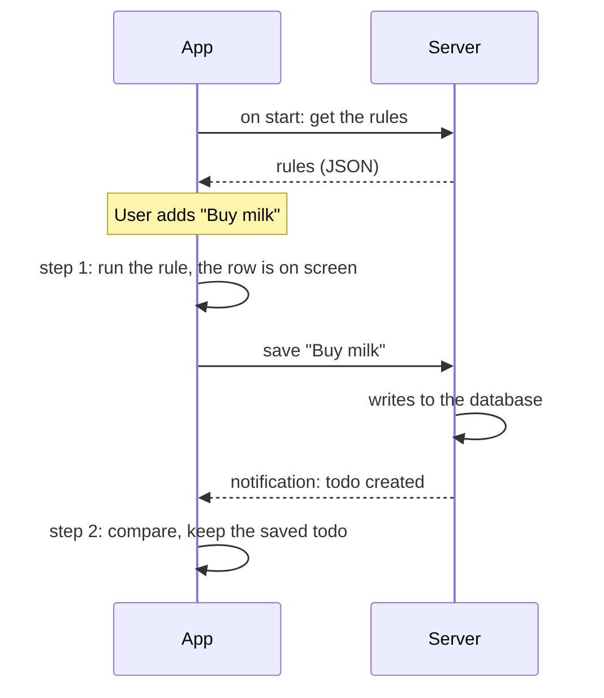

# How it works

This page explains what happens between the user's tap and the server's
answer. For what the library is for, start with the [README](readme.html).

## The idea

The server already tells the app about every change. After a todo is
created, an Ash notifier sends "todo created" with the saved todo over
the WebSocket, and the app updates its list from it. This library starts
from that.

A rule is a description, written in advance, of the notification the
server will send after an action. The server compiles every rule to
[JSON Logic](https://jsonlogic.com), a small portable format for
expressions, and the app downloads them when it starts. Then:

1. **The user taps.** The app runs the rule against what it already
   holds and updates its state at once: the row is in the list.
2. **The notification arrives.** The server finished saving and sent
   the real notification. The app compares it with its guess and keeps
   the real data. If the guess was right, the user sees nothing change.



The rules live on the server only. The app runs them; it never owns
them.

## The example

A todo app. Adding a todo puts it at the end of the list. Completing one
ticks it and gives 10 XP, which the user's level adds up:

```elixir
# MyApp.Todo
optimistic_ui do
  optimistic :create do
    insert at: :end
  end

  optimistic :complete do
    where expr(not done) do
      set :done, true
      push :xp_awarded, amount: 10
    end
  end
end

# MyApp.UserLevel
optimistic_ui do
  on :xp_awarded do
    set :total_xp, expr(total_xp + event(:amount))
  end
end
```

## Before the tap: the server builds the rules

When a resource compiles, its `optimistic_ui` block is checked. A wrong
action name, a `set` on something that is not an attribute, or an
expression the app could not run (a relationship, the actor, an
unsupported function) stops the compile.

Simple changes on the action are turned into `set`s for you: the fields the
action accepts, `atomic_update`, `set_attribute`, and change modules
that describe themselves. See
[What a rule may read](expressions.md#what-is-taken-from-the-action).

`AshBackendDrivenOptimisticUi.Registry.rules()` collects every rule of
every domain into one payload. [On the wire](on-the-wire.md) shows the
payload for `:complete`. In it:

- A rule's key is `<type>.<action>`. The type is the resource's JSON:API
  type, or its module name underscored (`MyApp.UserLevel` is `user_level`).
- A `set` is a field of the record as the notification will carry it. A
  `push` is another notification the action causes, such as `xp_awarded`.
- `reactions` come attached to the rule: every `on`, from any resource,
  that answers an event this rule sends, then the events those send, and
  so on. Each `{event, type}` runs once, so loops end.
- `version` is a hash of all the rules. It changes when any rule changes,
  so the app knows to download them again.
- `"source"` says whether a `set` was taken from the action (`derived`) or
  written in the block (`declared`).

Serve the payload from an endpoint. `Registry.version()` returns just the
hash, so the server can send it cheaply, for example when the app
connects. A deploy with changed rules reaches every app without an app
release.

## Step 1: the user taps

Before it sends the request, the app:

1. Looks up the rule, `todo.complete`. With no rule, it sends the request
   and waits, as before.
2. Keeps a copy of every record it is about to change.
3. Runs the rule with these variables:
   - `record`: the todo as the app holds it,
   - `input`: what is being sent,
   - `ctx`: facts the server put on the todo (see below).
4. Applies the `set`s: the todo is ticked.
5. Shows each `push` as if it had arrived: the "+10 XP" toast. It
   remembers the push's id.
6. Runs the `reactions` on the records it holds of that type, with
   `event` set to the push's payload: the level's total goes up by 10.
7. Sends the request, with the ids of the pushes it showed.

For `:create` the app builds the new row from the `set`s (here, the
typed title), gives it a temporary id, and puts it where `insert` says.

## Step 2: the notification arrives

The server runs the real action as always and sends its notifications.
Meanwhile the user already sees the result. Then the app:

- **Takes the real record.** The saved todo replaces the guess. A new
  row's temporary id is swapped for the real one. If the guess was right,
  nothing on screen changes.
- **Skips what it already showed.** The real `xp_awarded` carries the same
  id as the one the app showed, so the toast is not shown twice.
- **Undoes a wrong guess.** If the save fails, or the server says it did
  not send a push the app showed, the app puts back the copies it kept.

The server always has the last word.

The server's answer to the request also lists the pushes it really sent
and the ids it did not, so the app can settle without waiting for the
WebSocket. The library builds that list
(`AshBackendDrivenOptimisticUi.PushCollector.drain_reconciliation/1`);
your app sends it with the answer, over whatever transport it uses.
[On the wire](on-the-wire.md) shows every message of one tap as JSON.

## Two kinds of effects: properties and events

Everything a rule does is one of two kinds. They behave differently when
a guess is wrong, so it helps to know which one you are writing.

**Properties** are fields of a record: `set`, and the list effects
`insert`, `remove`, `edit` and `clear`.

- The guess is a value on screen: the todo is ticked, the row is in the
  list.
- The server always sends the real record after the write. It replaces
  the guess, so a wrong property fixes itself. Nothing extra is needed.

**Events** are one-time things that happen: `push`, such as the "+10 XP"
toast. A reaction (`on :xp_awarded`) answers an event by changing
properties of another record.

- An event is not a field, so no real record ever arrives to replace it.
- It needs an id, so the app can tell that the real event from the server
  is the one it already showed, and not show it twice. See the next
  section.
- If the server never sends the event, nothing arrives at all. Silence
  cannot say "that did not happen". This is the one case the list in the
  server's answer exists for: when an event the app showed is missing
  from it, the app puts back the records that event's reactions changed.

| | Properties | Events |
|---|---|---|
| Written as | `set`, `insert`, `remove`, `edit`, `clear` | `push`, answered by `on` |
| Example | the todo is ticked | the "+10 XP" toast |
| Corrected by | the real record the server sends | the list of pushes in the answer |
| Needs an id | no | yes |

A rule with only properties needs nothing but the server's usual
notifications. Only rules with events need the list in the answer.

## When things go wrong

There are two cases, and the answer to the save settles both. Nothing
waits on a timer.

- **The save fails.** The server answers with an error. The app undoes
  everything it showed for that save.
- **The save works, but an event the rule promised was not sent.** The
  answer lists the events the server really sent. An event the app showed
  that is not in the list did not happen, so the app undoes what it showed
  for that save, and the real records arrive by notification as always.

A toast already on screen is not taken back; only data is undone.

Send the events inside the action, so they succeed or fail with it. An
event sent later, from another process, is not in the answer and must not
be in a rule.

## Event ids

A toast shown at once and the same toast from the server must have the
same id. The library makes both from one function,
`AshBackendDrivenOptimisticUi.PushId.for/3`, using the record as it was
before the write:

```
<type>:<record id>:<updated_at>:<event>:<label>
todo:42:2026-10-25T18:03:00.123456Z:xp_awarded:complete
```

`label` is the action for a push in `optimistic`, and the answered event
for a push in `on`. `updated_at` changes on every write, so each write
gets new ids and nothing has to be stored.

Two places use it:

- **The rule.** Every push in an update or destroy rule reads its id from
  `ctx.push_ids.<event>.<label>`. The compiler adds this; a rule that
  writes `id:` itself fails to compile. Put the ids into `ctx` with
  `PushId.for_record/1` (see below).
- **Your notifier.** Where the server really sends the event, give it the
  id `PushId.for(record_before_the_write, :xp_awarded, :complete)`.

A create, or a generic action, has no record before the write, so its
pushes have no id, and the app cannot match the real one to the one it
showed.

## `ctx`

A rule only sees what the app holds. When it needs a fact the app cannot
work out (the XP this tap is worth today, a translated message), the
server puts it in a map calculation named `ctx` on the resource. The app
gets `ctx` with the record. A rule reads it with `^context(:name)`, which
compiles to `ctx.name`.

A resource whose rules push needs `ctx` for the event ids:

```elixir
defmodule MyApp.OptimisticCtx do
  use Ash.Resource.Calculation

  @impl true
  def load(_query, _opts, _context), do: [:updated_at]

  @impl true
  def calculate(records, _opts, _context) do
    Enum.map(records, &%{push_ids: AshBackendDrivenOptimisticUi.PushId.for_record(&1)})
  end
end

# on MyApp.Todo
calculations do
  calculate :ctx, :map, MyApp.OptimisticCtx, public?: true
end
```

Add your own facts to the same map, and make sure the app loads `ctx`
with the record.

## What a client needs

No client is published yet. One needs:

- a standard JSON Logic evaluator: any package that passes the official
  tests at <https://jsonlogic.com/tests.json>, plus five small custom
  operations added to it:
  - `has`: `{"has": "input.name"}` returns true when the path's last key is
    present, even with a null value;
  - `round`: `round(x)` returns the nearest whole number, halves away from
    zero; `round(x, places)` rounds to that many decimal places;
  - `abs`: returns the absolute value of its one operand;
  - `to_string`: returns its operand as text; null becomes empty text;
  - `now`: takes no operands and returns the current UTC time as ISO 8601
    text.

  The library's Elixir evaluator, `AshBackendDrivenOptimisticUi.JsonLogic`,
  is the reference; the test helpers use it. The repository's
  `test/fixtures` hold two test files a client can run:
  `json_logic_official_tests.json` (the official suite) and
  `json_logic_extras_tests.json` (the custom operations and the places
  where this library's evaluator is stricter than JavaScript);
- the two steps above: apply and remember, then settle when the real
  data arrives.

Which custom operations a client meets depends on the rules:

- `has` and `to_string` appear in rules whose author never wrote them. The
  library puts `has` into every update rule, once per field the action
  accepts, and wraps every part of a `<>` join in `to_string`. Add these
  two first.
- `round`, `abs` and `now` appear only when a rule's author writes them.

When a client cannot run a rule, for example because an operation is
missing or a value is not a number, it should show nothing early for that
action and log the rule's name. The save still goes to the server and the
real data arrives as usual, so the user only loses the instant update.

## What is still written twice

The library does not read your notifiers. A `push` repeats the event name
and the payload fields your notifier sends:

```elixir
push :xp_awarded, amount: 10   # the rule
# ...and your notifier sends "xp_awarded" with %{amount: 10}
```

The `optimistic` test helper catches a mismatch: with `topics:`, it fails
unless every `push` of the rule was really sent, with the same name, id
and fields. The real event may carry more fields than the rule. A number
the server sends as text (`"7"`) matches the number `7`. See
[How to test](testing.md).

## Why the limits

- The app runs the rule, so a rule can only use what JSON Logic and the
  five custom operations can express.
- The app holds records, not their relationships or the actor, so a rule
  cannot read them. Use a calculation, an aggregate or `ctx`.
- The library never guesses what a change module does. A change module
  adds to the rule only when it describes itself with `optimistic_sets/1`.
- Without a notification, nothing confirms the guess, so a resource has
  to send its changes to the app.
- Whether some resource sends the event an `on` waits for is not checked
  at compile time, because one resource cannot see the others then.
  `AshBackendDrivenOptimisticUi.Registry.rule_resources/1`,
  `AshBackendDrivenOptimisticUi.Rules.for_resource/1` and
  `reactions_for_resource/1` list both sides, so a test in your app can compare
  them.
